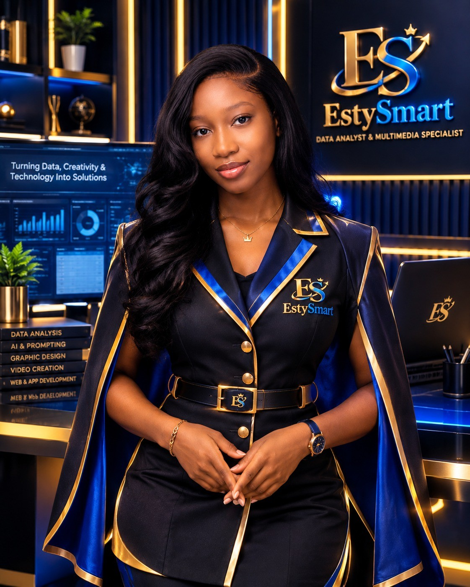
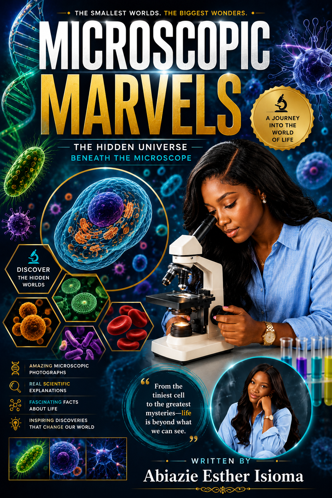
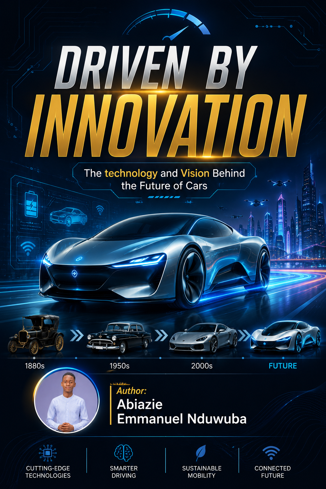
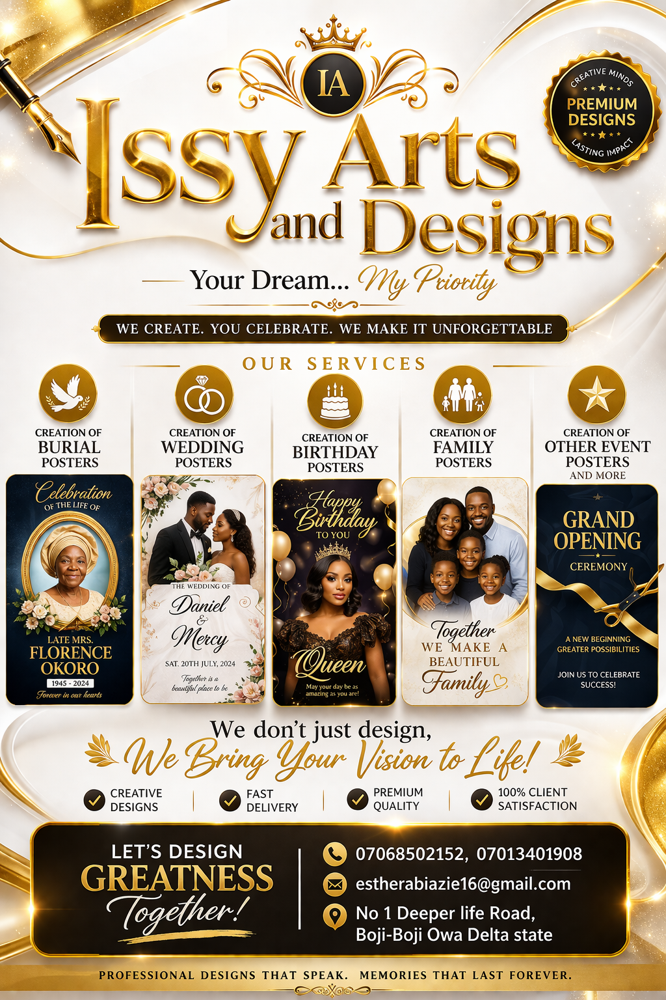

  <h1>✦ ESTYSMART ✦</h1>
  <h3>ESTHER ISIOMA ABIAZIE</h3>
  
<strong>CREATIVITY · TECHNOLOGY · INNOVATION · IMPACT</strong>

  
  
  

 

<table>
<tr>
<td width="65%" valign="middle">

<h2>Transforming Ideas Into Digital Impact.</h2>

I am <strong>Esther Isioma Abiazie</strong>, also known as
<strong>EstySmart</strong> — an aspiring digital professional
combining analytical thinking, creative design and emerging
technology to develop meaningful digital experiences.

<h3>✦ AREAS OF FOCUS</h3>

◆ Data Analysis & Interpretation 
◆ Multimedia & Visual Design 
◆ Web Development & Digital Solutions 
◆ AI-Assisted Content Creation 
◆ Cybersecurity & DevSecOps Fundamentals

<h3>✦ CONNECT WITH ME</h3>

</td>

<td width="35%" align="center" valign="middle">

<h3>ESTYSMART</h3>

<em>Digital Creativity & Innovation</em>

</td>
</tr>
</table>

  <h3>BUILDING · CREATING · INNOVATING</h3>
  
<em>Turning vision into intelligent digital experiences.</em>

---

# ESTYSMART | Esther Isioma Abiazie

### Data Analyst | Multimedia Specialist | Cybersecurity & DevSecOps Enthusiast | Digital Solutions Creator

**CREATIVITY. TECHNOLOGY. INNOVATION. IMPACT.**

---

## ABOUT ME

Welcome to my digital space!

I am **Esther Isioma Abiazie**, professionally known as **EstySmart** — an aspiring digital professional passionate about combining creativity, analytical thinking and technology to develop meaningful digital experiences.

My interests span data analysis, multimedia design, web development, artificial intelligence, digital content creation, cybersecurity fundamentals and emerging technologies.

I enjoy transforming ideas into creative digital solutions, communicating information visually and exploring how technology can solve real-world problems.

My professional philosophy is simple:

**Think creatively. Analyse intelligently. Build innovatively. Create impact.**

---

## SKILLS & EXPERTISE

### DATA & ANALYTICS
- Data Analysis
- Data Interpretation
- Analytical Thinking
- Data Presentation
- Microsoft Excel and Data-related Tools

### MULTIMEDIA & VISUAL DESIGN
- Graphic Design
- Visual Design
- Multimedia Design
- Digital Advertising
- Content Creation
- Pitch Deck Design
- Microsoft PowerPoint

### DIGITAL DEVELOPMENT
- Web Development
- Website Design
- AI-assisted Website and Application Creation
- Digital Solutions Development

### ARTIFICIAL INTELLIGENCE
- AI Prompt Engineering
- AI-assisted Graphics Creation
- AI Video Creation
- AI Content Creation
- AI-assisted Digital Workflows

### CYBERSECURITY & EMERGING TECHNOLOGY
- Cybersecurity Fundamentals
- DevSecOps Principles
- Technology Research
- Digital Security Awareness

---

## PROFESSIONAL SERVICES

I am interested in contributing to projects involving:

- Data Analysis and Presentation
- Graphic and Visual Design
- Multimedia Content Creation
- Website Design and Development
- AI-assisted Digital Content
- Pitch Deck and Presentation Design
- Digital Branding and Advertising
- Creative Digital Solutions

---

## FEATURED PROJECTS

A selection of independent creative, educational and digital project concepts.

### 1. ESTYSMART — PERSONAL PORTFOLIO

My personal professional portfolio showcasing my skills, training, projects, services and digital interests.

**Focus:** Personal Branding | Web Design | Digital Presentation

[Visit My Portfolio](https://estysmart17.github.io)

### 2. ABI-JO AUTOMOBILES

An automotive website concept focused on presenting vehicle-related services through a professional digital experience.

<table>
<tr>
<td width="65%" valign="middle">

<h2>✦ ABI-JO AUTOMOBILES ✦</h2>

<h3>Automotive Excellence. Driving Innovation.</h3>

A modern automotive website concept designed to showcase
vehicles through an elegant digital showroom and deliver
a professional online browsing experience.

<strong>PROJECT CATEGORY</strong>

Web Development · Automotive · Digital Solutions

<em>Bringing automotive discovery and digital experiences together.</em>

<a href="https://abi-joautomobiles.lovable.app/">
<strong>↗ EXPLORE LIVE WEBSITE</strong>
</a>

</td>

<td width="35%" align="center" valign="middle">

</td>
</tr>
</table>

---

**Focus:** Website Design | Automotive Branding | Digital Presentation

### 3. NOVELORA

A digital reading and writing platform concept designed around discovering, reading and publishing stories.

**Focus:** Web Development | Digital Publishing | User Experience

### 4. ABI-J REAL ESTATE CONSULTANCY COMPANY

A real estate branding and promotional design concept focused on professional property presentation.

**Focus:** Visual Design | Real Estate Branding | Advertising

### 5. MICROSCOPIC MARVELS

**The Hidden Universe Beneath the Microscope**

An educational science ebook introducing readers to the fascinating microscopic world.

<table>
<tr>
<td width="65%" valign="middle">

<h2>✦ MICROSCOPIC MARVELS ✦</h2>

<h3>The Hidden Universe Beneath the Microscope</h3>

An educational science ebook exploring the fascinating microscopic
world, cellular structures, microorganisms and the science of life.

<strong>PROJECT CATEGORY</strong>

Educational Publishing · Life Sciences · Scientific Exploration

<em>Discovering the extraordinary hidden world beyond the naked eye.</em>

</td>

<td width="35%" align="center" valign="middle">

</td>
</tr>
</table>

---

**Focus:** Educational Writing | Science Communication | Ebook Design

### 6. DRIVEN BY INNOVATION

**The Technology and Vision Behind the Future of Cars**

An educational ebook exploring automotive technology, innovation and the future of mobility.

<table>
<tr>
<td width="65%" valign="middle">

<h2>✦ DRIVEN BY INNOVATION ✦</h2>

<h3>The Technology and Vision Behind the Future of Cars</h3>

An educational ebook exploring automotive technology,
engineering, innovation and the future of mobility.

<strong>PROJECT CATEGORY</strong>

Educational Publishing · Automotive Technology · Research

<em>Exploring tomorrow's automotive world through technology and vision.</em>

</td>

<td width="35%" align="center" valign="middle">

</td>
</tr>
</table>

---

**Focus:** Technology Research | Educational Writing | Automotive Innovation

---
### 7. ISSY ARTS AND DESIGN

**Your Dream, My Priority**

Transforming creative visions into captivating designs that make every dream unforgettable.

<table>
<tr>
<td width="65%" valign="middle">

<h2>✦ ISSY ARTS AND DESIGN ✦</h2>

<h3>Your Dream, My Priority.</h3>

A creative design brand focused on graphic design,
visual branding, logo creation, promotional flyers
and captivating digital artwork.

<strong>PROJECT CATEGORY</strong>

Graphic Design · Visual Branding · Digital Creativity · Multimedia Design

<em>Bringing creative visions to life through exceptional design.</em>

</td>

<td width="35%" align="center" valign="middle">

</td>
</tr>
</table>

---

## EDUCATION & PROFESSIONAL TRAINING

**St. Agnes Group of School**
- Secondary Education
- WAEC/WASSCE — 2026

**Professional Training**
- Data Analysis — 2025
- Microsoft PowerPoint Presentation — July–August 2025
- Microsoft Word Processing — 2025
- Multimedia Specialist Training — 2026
- AI-assisted Digital Creation and Prompt Engineering

---

## TECHNOLOGY & PROFESSIONAL INTERESTS

I am continuously interested in exploring:

- Data-driven decision-making
- Artificial Intelligence and automation
- Cybersecurity and digital protection
- DevSecOps and secure development principles
- Modern web technologies
- Multimedia innovation
- Digital entrepreneurship
- Creative problem-solving

I believe that continuous learning and practical experimentation are essential to growth in the digital world.

---

## LET'S CONNECT

I welcome opportunities to learn, collaborate, contribute to meaningful projects and connect with people working across technology and creative industries.

---

### ESTYSMART

**Creativity. Technology. Innovation. Impact.**

*Transforming ideas into intelligent digital experiences.*
